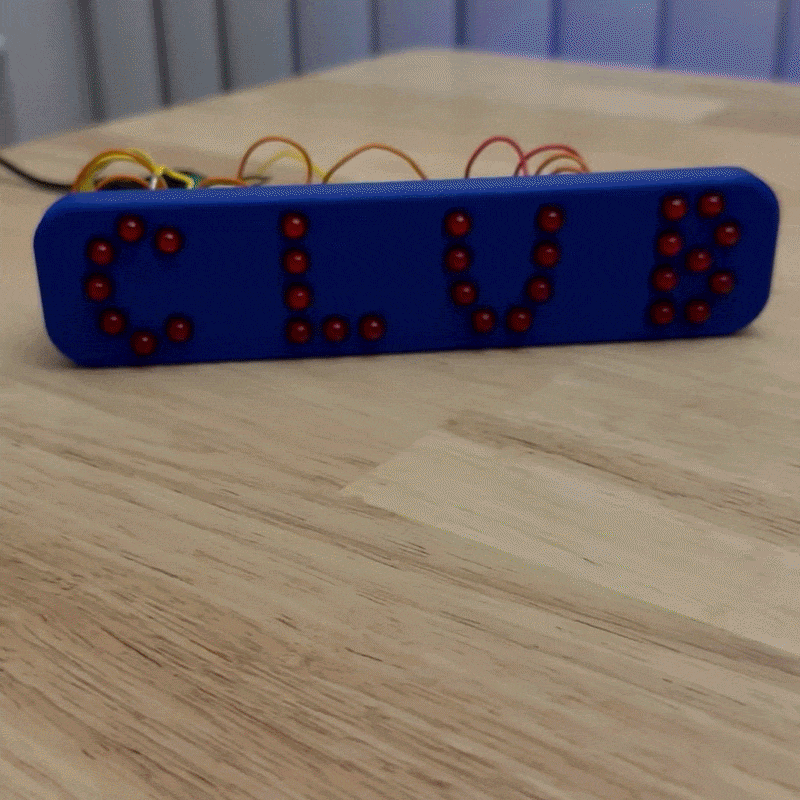

# 555 Timer Club Display Sign

> A custom illuminated table display sign created for the WCC Beginner Electronics Club using a 555 timer circuit.

## Overview
* **Status:** Completed
* **Core Technology:** 555 Timer IC, LED Circuitry, Autodesk Fusion, 3D Printing
* **Primary Objective:** Build an eye-catching hardware table display for student club recruitment and event tables.

---

## Hardware & Features
* **Timer Circuit:** 555 Timer IC configured for pulse/flash control
* **Display:** Custom LED layout / illuminated branding
* **Enclosure/Frame:** Designed in Autodesk Fusion and 3D printed / assembled

---

## Build Gallery
| Testing & Design | Operation / Showcase |
| :---: | :---: |
|  |  |
| :---: | :---: |
|  |  |
| :---: |
|  |

---

## Future Polish / Next Steps
- [ ] Add complete circuit schematic diagram.
- [ ] Upload Autodesk Fusion 3D model files (.STL / .STEP).
